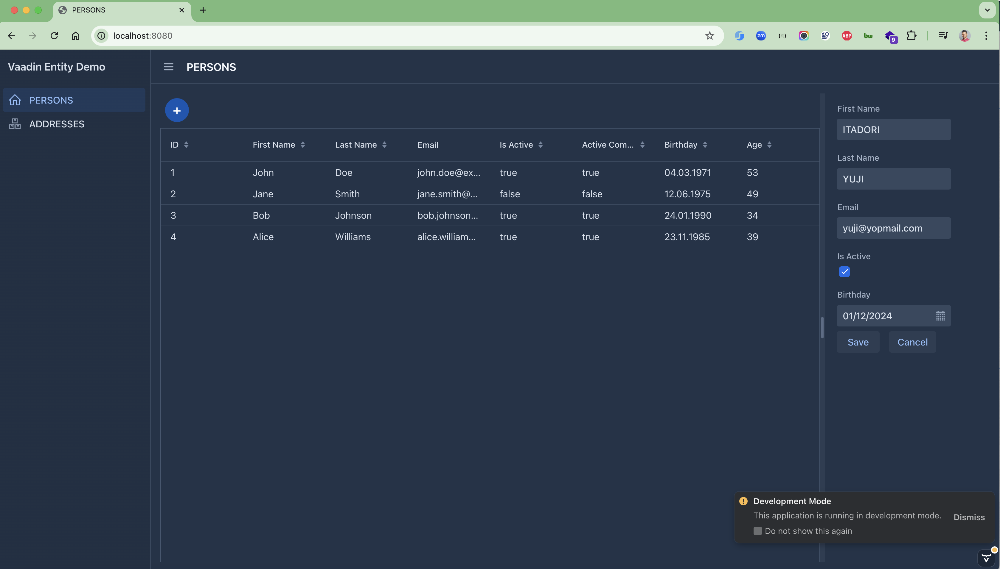
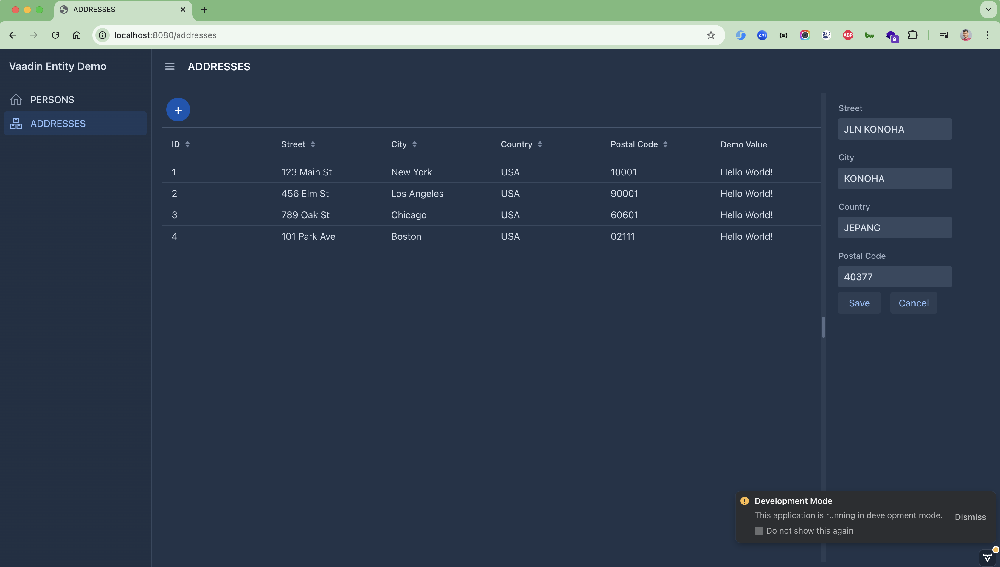

# spring-boot-vaadin-grid-form-entities

[](https://github.com/hendisantika/spring-boot-vaadin-grid-form-entities/actions/workflows/maven.yml)


[](.github/dependabot.yml)

A small Spring Boot + Vaadin Flow demo that renders a **generic Grid and Form for any entity**.
Grid columns and form fields are declared with custom annotations (`@GridColumn`, `@FormField`) on the entity
classes, and a single reusable `GenericView` builds the CRUD UI from them.

## Tech Stack

| Component    | Version |
|--------------|---------|
| Java (JDK)   | 25      |
| Spring Boot  | 4.1.x   |
| Vaadin Flow  | 25.x    |
| Lombok       | managed by Spring Boot |
| Maven        | 3.10.x (via Maven Wrapper) |

## Project Structure

```
src/main/java/id/my/hendisantika/vaadingridformentities
├── entity      # Person, Address, BaseEntity (annotated with @GridColumn / @FormField)
├── service     # DataService – in-memory data store
├── ui          # GridColumn, FormField annotations & GenericView (Grid + Form builder)
└── view        # MainLayout (AppLayout + SideNav), PersonView, AddressView
```

## Requirements

- JDK 25 (e.g. [Eclipse Temurin](https://adoptium.net/))
- No local Maven installation needed — use the bundled Maven Wrapper (`./mvnw`)

## Things todo list

1. Clone this repository: `git clone https://github.com/hendisantika/spring-boot-vaadin-grid-form-entities.git`
2. Navigate to the folder: `cd spring-boot-vaadin-grid-form-entities`
3. Make sure `JAVA_HOME` points to JDK 25: `java -version`
4. Run the application: `./mvnw clean spring-boot:run`
5. Open your favorite browser: http://localhost:8080

| Route        | View        |
|--------------|-------------|
| `/`          | Persons     |
| `/addresses` | Addresses   |

### Build & Test

```bash
# Run tests and build the jar
./mvnw clean package

# Production build (pre-compiled frontend bundle)
./mvnw clean package -Pproduction
java -jar target/vaadin-grid-form-entities-0.0.1-SNAPSHOT.jar
```

## CI/CD & Dependency Management

- **GitHub Actions** ([`maven.yml`](.github/workflows/maven.yml)) builds and tests the project on JDK 25 (Temurin)
  for every push and pull request to `main`, and submits the Maven dependency graph on `main`.
- **Dependabot** ([`dependabot.yml`](.github/dependabot.yml)):
  - Maven dependencies are checked **daily** (05:00 Asia/Jakarta) and grouped into
    `spring-boot`, `vaadin`, `test`, `maven-plugins` and `lombok` PRs.
  - GitHub Actions are checked **weekly** and grouped into a single PR.
  - PRs are labeled and use conventional commit prefixes (`chore(deps)`, `ci(deps)`).

## Image Screenshot

Person UI



Address UI


